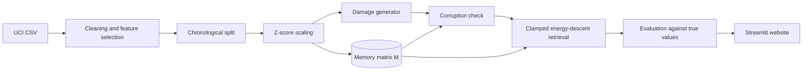

# Missing Sensor Pattern Reconstruction Using Hopfield Networks

**SensorRecover AI: project report**

---

## Abstract

Environmental sensor networks regularly lose data through power failures, calibration, drift and communication faults. This project builds a Hopfield-based associative memory that reconstructs missing or corrupted readings in multivariate air-quality data. Classical Hopfield networks store binary patterns, whereas sensor readings are continuous, so two formulations were implemented and compared: a classical binary network using thermometer encoding, and a modern continuous Hopfield network that stores real-valued patterns. The system was tested on the UCI Air Quality dataset (9,357 hourly records from a real field deployment) using a chronological train, validation and test split. Readings were hidden at rates of 10% to 50% in two patterns, random gaps and 24-hour sensor outages, and results were compared with mean imputation, K-nearest-neighbour imputation and linear interpolation. Scoring used only artificially hidden readings, whose true values are known.

The continuous network clearly outperformed the binary network and mean imputation, and matched KNN when both received the same 3-hour input (average RMSE 0.555 against 0.550, in standard deviations). Linear interpolation was best on random gaps, but on 24-hour outages its RMSE was about 0.96, against about 0.64 for the memory-based methods.

---

## 1. Introduction

Air-quality monitoring supports public health decisions, pollution control and research. These decisions depend on complete data, yet real sensors do not deliver it. In the dataset used here, the reference analysers for CO, NOx and NO2 are each missing for about 18% of all hours.

Sensors in one location do not act independently. When traffic increases, CO, benzene and NOx rise together. Temperature and humidity follow a daily cycle. So when one sensor fails, the others still say a lot about what it would have read.

An associative memory fits this situation well. It stores complete examples of what the sensors looked like together, and when it receives a partial example, it recalls the most consistent complete pattern. The Hopfield network is the classic model of such a memory.

---

## 2. Problem definition

**Input:** a table of hourly readings from several sensors, in which some values are missing or wrong.

**Output:** the same table with those values replaced by estimates.

**Formally:** let $x_t \in \mathbb{R}^d$ be the readings of $d$ sensors at hour $t$. A mask divides $x_t$ into known values $x_t^{K}$ and unknown values $x_t^{U}$. The task is to estimate $x_t^{U}$ from $x_t^{K}$ and from patterns stored during training, so that the error between the estimate and the true value is small.

---

## 3. Objectives

1. Use a real, public, multivariate environmental dataset, and cite its source.
2. Implement a Hopfield associative memory that handles continuous readings correctly.
3. Measure reconstruction at 10%, 20%, 30%, 40% and 50% missing data.
4. Compare it fairly with mean, KNN and linear interpolation baselines.
5. Report MAE, MSE, RMSE and R² using known true values only.
6. Provide an interactive website for exploring the data, the damage and the results.

---

## 4. Literature review

**Classical Hopfield networks.** Hopfield (1982) showed that a network of binary neurons with symmetric weights has an energy function that never increases, so stored patterns become stable attractors. Hopfield (1984) extended the idea to graded neurons. Amit, Gutfreund and Sompolinsky (1985) showed that Hebbian storage holds only about $0.138N$ random patterns in $N$ neurons, and correlated patterns are worse.

**Better storage rules.** Personnaz, Guyon and Dreyfus (1985) and Kanter and Sompolinsky (1987) introduced the projection (pseudo-inverse) rule, which stores correlated patterns exactly, for up to $N$ patterns.

**Modern Hopfield networks.** Krotov and Hopfield (2016) showed that sharper interaction functions greatly increase capacity. Demircigil et al. (2017) proved exponential capacity for an exponential interaction. Ramsauer et al. (2021) extended this to continuous states, proved that the update converges, and showed that the update has the same form as transformer attention.

**Missing data.** Rubin (1976) and Little and Rubin (2019) define the missing-data mechanisms used in this field. Troyanskaya et al. (2001) established KNN imputation, which remains a strong baseline. Multiple imputation (van Buuren and Groothuis-Oudshoorn, 2011) and generative approaches such as GAIN (Yoon et al., 2018) are more recent alternatives.

**The dataset.** De Vito et al. (2008) collected this data to study field calibration of low-cost gas sensors. It is widely used as a benchmark.

---

## 5. Existing system

Common practice for filling sensor gaps:

| Method | How it works | Main weakness |
|---|---|---|
| Mean imputation | Uses the sensor's average | Ignores current conditions and flattens variation |
| Linear interpolation | Draws a line between readings before and after the gap | Fails on long gaps, and needs future data |
| KNN imputation | Averages the most similar past rows | Hard cut-off at K neighbours, no notion of convergence or energy |

---

## 6. Proposed system

SensorRecover AI treats reconstruction as memory recall. Real, complete training patterns are stored as memories. When a damaged pattern arrives, the known readings are clamped and the network updates only the unknown neurons until it settles in a low-energy state. A corruption check uses the same memory to flag readings that disagree with the other sensors, and those are then treated as unknown.

---

## 7. Dataset

**Name:** Air Quality. **Source:** UCI Machine Learning Repository.
**Page:** https://archive.ics.uci.edu/dataset/360/air+quality
**Download:** https://archive.ics.uci.edu/static/public/360/air+quality.zip
**DOI:** 10.24432/C59K5F. **Licence:** CC BY 4.0.
**File used:** `data/AirQualityUCI.csv`, SHA-256 `13277ae5d8581e80b7be09d47c7d3d06fe9b8e957078f2cf6e859f955e62f996`.

**Why UCI and not Kaggle?** UCI is the original deposit by the researchers. The Kaggle versions are re-uploads of this same data, and an original source with a DOI is easier to cite and verify.

**Size:** 9,357 hourly records from 10 March 2004 to 4 April 2005. The published file has 9,471 rows and 17 columns, of which 114 rows and 2 columns are blank.

| Column | Meaning | Unit | Missing |
|---|---|---|---|
| CO(GT) | Carbon monoxide, reference analyser | mg/m³ | 1,683 (18.0%) |
| PT08.S1(CO) | Tin-oxide sensor targeting CO | sensor response | 366 (3.9%) |
| NMHC(GT) | Non-methane hydrocarbons, reference analyser | µg/m³ | 8,443 (90.2%) |
| C6H6(GT) | Benzene, reference analyser | µg/m³ | 366 (3.9%) |
| PT08.S2(NMHC) | Titania sensor targeting NMHC | sensor response | 366 (3.9%) |
| NOx(GT) | Nitrogen oxides, reference analyser | ppb | 1,639 (17.5%) |
| PT08.S3(NOx) | Tungsten-oxide sensor targeting NOx | sensor response | 366 (3.9%) |
| NO2(GT) | Nitrogen dioxide, reference analyser | µg/m³ | 1,642 (17.5%) |
| PT08.S4(NO2) | Tungsten-oxide sensor targeting NO2 | sensor response | 366 (3.9%) |
| PT08.S5(O3) | Indium-oxide sensor targeting O3 | sensor response | 366 (3.9%) |
| T | Temperature | °C | 366 (3.9%) |
| RH | Relative humidity | % | 366 (3.9%) |
| AH | Absolute humidity | g/m³ | 366 (3.9%) |

**Corrupted observations.** Failed readings are stored as the code `-200`, which looks like a measurement. Left in place, it would badly distort any statistic, so it is converted to an empty value.

---

## 8. Methodology

### 8.1 Preprocessing

1. **Parsing.** Read semicolon-separated values with decimal commas, and build real timestamps.
2. **Cleaning.** Remove blank rows and columns, and convert `-200` to empty.
3. **Feature selection.** Drop `NMHC(GT)`, which is 90.2% empty. Twelve columns remain.
4. **Chronological split.** First 70% for training (6,549 rows), next 15% for validation (1,404), last 15% for testing (1,404). A random split would be wrong here, because neighbouring hours are nearly identical, so test rows would have near-copies in training.
5. **Normalisation.** Z-score each sensor using training statistics only: $z = (x - \mu)/\sigma$.
6. **Natural gaps stay empty.** Only complete training patterns are stored. Nothing invented enters the memory.

### 8.2 Natural and artificial gaps

| | Natural gap | Artificial gap |
|---|---|---|
| Origin | Missing in the real data | Hidden by us |
| True value known? | No | Yes |
| Used for scoring? | **Never** | Yes |

Artificial damage is only applied to cells that really contain a reading.

### 8.3 Damage patterns

- **Random gaps:** cells hidden uniformly at random. This is "missing completely at random" (MCAR).
- **Sensor outages:** one sensor hidden for 24 consecutive hours, repeated until the target rate is reached. This is closer to real device failure.
- **Corruption:** Gaussian noise, sudden spikes, or a stuck sensor. No method is told where these are.

### 8.4 Fair comparison

- All methods are tuned on the validation period only. The test period is used once, for final numbers.
- In each run, all methods receive exactly the same damaged table.
- Each setting is repeated with 5 random seeds.
- Because the 3-hour window helps Hopfield, KNN is also tested with the same window. Otherwise the window's gain would be wrongly credited to the Hopfield idea.

---

## 9. System architecture

| Layer | File |
|---|---|
| Hopfield models | `models/hopfield.py` |
| Loading, cleaning, damage | `utils/preprocessing.py` |
| Baselines, metrics, tuning, benchmark | `utils/evaluation.py` |
| Charts | `utils/visualization.py` |
| Shared app state and theme | `utils/state.py`, `utils/ui.py` |
| Website | `app.py`, `app_pages/` |
| Reproducing all results | `run_experiments.py` |
| Tests | `tests/` |

---

## 10. Mathematical formulation

### 10.1 Classical binary network

**Encoding.** Each reading becomes +1/-1 bits with a thermometer code. With $L$ levels, level $k$ turns on the first $k$ of $L-1$ bits. For example, with 5 levels, level 2 is `++--`.

Why not ordinary binary? In ordinary binary, 7 (`0111`) and 8 (`1000`) differ in every bit, even though they are neighbours. In a thermometer code, close values differ in few bits, so the network's notion of distance matches real distance. Levels come from training quantiles, so each level is equally common.

**Weight matrix.** For $P$ stored patterns $\xi^{\mu} \in \{-1,+1\}^N$:

Hebbian rule: $$W_{ij} = \frac{1}{N}\sum_{\mu=1}^{P}\xi_i^{\mu}\xi_j^{\mu}, \qquad W_{ii}=0$$

Pseudo-inverse rule, with $\Xi$ the $P \times N$ pattern matrix: $$W = \Xi^{\top}(\Xi\Xi^{\top})^{+}\Xi, \qquad W_{ii}=0$$

**Energy:** $$E(s) = -\tfrac12 \sum_{i,j} W_{ij}\, s_i s_j$$

**Update**, one neuron at a time: $$s_i \leftarrow \operatorname{sign}\Big(\sum_j W_{ij}s_j\Big)$$

With symmetric $W$ and zero diagonal, each update can only keep or lower the energy, so the network must settle.

**Capacity problem.** Hebbian storage holds about $0.138N$ random patterns. With the tuned 16 levels and 12 sensors, $N = 12 	imes 15 = 180$, so about 25 patterns, whereas the training data has 4,626. So K-means first reduces the training data to a few typical states, which loses detail. That is the main reason the continuous network was chosen.

### 10.2 Modern continuous network (main model)

**Storage.** The memory matrix $M \in \mathbb{R}^{P \times n}$ has one complete, real, z-scored pattern per row. No weights are learned. The patterns are the parameters. With a 3-hour window, a pattern is $[x_{t-1}, x_t, x_{t+1}]$, so $n = 36$.

**Weighted distance** from state $\xi$ to memory $m_i$: $$d_i(\xi) = \sum_{j} w_j (\xi_j - m_{ij})^2, \qquad w_j = \begin{cases}1 & \text{known neuron}\\ \gamma & \text{unknown neuron}\end{cases}$$

**Energy:** $$E(\xi) = -\frac{1}{\beta}\log\sum_{i=1}^{P}\exp\!\Big(-\frac{\beta}{2}\,d_i(\xi)\Big)$$

**Update,** applied to unknown neurons only, with known neurons clamped: $$p = \operatorname{softmax}\!\Big(-\frac{\beta}{2}\,d(\xi)\Big), \qquad \xi^{U} \leftarrow \sum_i p_i\, m_i^{U}$$

**Link to Ramsauer et al.** With $\gamma=1$, expanding the square gives $$E(\xi) = \tfrac12\xi^{\top}\xi - \frac1\beta\log\sum_i\exp\big(\beta(m_i^{\top}\xi + b_i)\big), \quad b_i = -\tfrac12\|m_i\|^2$$
This is their energy with one bias per memory. The bias matters: a pure dot product favours memories with large values, which here would mean recalling high-pollution hours too often. The resulting update has the same form as the mean-shift algorithm (Comaniciu and Meer, 2002). **The weight $\gamma$ is this project's own adaptation**, not part of the published model.

**Why energy never rises.** Fix the known neurons and write $y=\xi^{U}$. Then $$E(y) = -\frac1\beta\log\sum_i c_i\exp\!\Big(-\frac{\beta\gamma}{2}\|y-m_i^{U}\|^2\Big)$$ where $c_i$ depends on known neurons only. This is the negative log of a Gaussian mixture density, and the update is exactly the mean-shift (or EM) step for that mixture, which cannot lower the density (Comaniciu and Meer, 2002). Equivalently, it is a concave-convex procedure step (Yuille and Rangarajan, 2003). So energy cannot rise for any $\gamma>0$. The test suite also checks this numerically.

**What each setting does.**

- $\beta$ (sharpness): large values recall one close memory, small values blend many.
- $\gamma$ (trust in estimates): unknown neurons hold only guesses, so they count less than real readings.

**First update.** The first step sets $\gamma=0$, so memories are compared using real readings alone. Starting guesses cannot then bias the first recall. Later steps use the chosen $\gamma$.

### 10.3 Why this approach is appropriate

| Requirement | Binary network | Continuous network |
|---|---|---|
| Keeps real values | No, rounded to levels | Yes |
| Stores thousands of patterns | No, needs compression | Yes |
| Has an energy function and convergence | Yes | Yes |
| Partial-cue recall by clamping | Yes | Yes |

### 10.4 Metrics

Over the set $S$ of scored cells, with true values $y$ and estimates $\hat y$:

$$\text{MAE}=\frac{1}{|S|}\sum|y-\hat y|, \quad \text{MSE}=\frac{1}{|S|}\sum(y-\hat y)^2, \quad \text{RMSE}=\sqrt{\text{MSE}}, \quad R^2=1-\frac{\sum(y-\hat y)^2}{\sum(y-\bar y)^2}$$

Overall metrics use z-scored values, because adding errors in mg/m³ to errors in °C would be meaningless. An RMSE of 0.5 means a typical error of half a standard deviation. Per-sensor errors in real units are also reported.

---

## 11. Algorithm

**Storing**

1. Clean the data, split it by time, and z-score it using training statistics.
2. Build patterns (single hours, or 3-hour windows).
3. Keep only patterns with no natural gaps. These rows form $M$.

**Reconstructing a damaged table**

1. If corruption is possible, run the corruption check (below) and add flagged cells to the unknown set.
2. Build the query patterns. Mark every empty position as unknown.
3. First recall: compare memories with known neurons only, and fill unknown neurons with the softmax-weighted average of memories.
4. Repeat up to 20 times: compute weights using all neurons (unknown ones weighted by $\gamma$), update unknown neurons, and keep known neurons fixed. Stop early if the change is below $10^{-4}$.
5. Read the current hour from the settled pattern.
6. Convert from z-scores back to real units.

**Corruption check**

1. For each sensor, hide it, and recall it from the other sensors.
2. The residual is the gap between the reading and the recalled value.
3. Set one threshold per sensor, at the 99th percentile of residuals on validation data.
4. Flag readings above the threshold. Hide flagged readings, and repeat once, so bad readings cannot vouch for each other.

---

## 12. Results and discussion

All numbers come from `run_experiments.py` on the held-out test period (5 February to 4 April 2005), averaged over 5 random seeds, and are stored in `results/`. Errors are in standard deviations. Lower is better for RMSE, and higher is better for R².

**Settings chosen on the validation period:** 3-hour Hopfield $\beta=2,\ \gamma=0.05$; 1-hour Hopfield $\beta=8,\ \gamma=0.05$; binary network with 16 levels, 32 prototypes and the pseudo-inverse rule; KNN with $K=10$.

### 12.1 RMSE on random gaps

| Method | 10% | 20% | 30% | 40% | 50% |
|---|---|---|---|---|---|
| Hopfield (3-hour) | 0.441 | 0.448 | 0.454 | 0.470 | 0.492 |
| KNN (3-hour) | 0.438 | 0.447 | 0.455 | 0.470 | 0.487 |
| Hopfield (1-hour) | 0.582 | 0.603 | 0.641 | 0.684 | 0.739 |
| KNN (1-hour) | 0.571 | 0.593 | 0.629 | 0.669 | 0.726 |
| Hopfield (binary) | 0.763 | 0.803 | 0.846 | 0.903 | 0.963 |
| Linear interpolation | 0.291 | 0.322 | 0.348 | 0.394 | 0.444 |
| Mean imputation | 1.252 | 1.257 | 1.253 | 1.252 | 1.251 |

### 12.2 RMSE on 24-hour sensor outages

| Method | 10% | 20% | 30% | 40% | 50% |
|---|---|---|---|---|---|
| Hopfield (3-hour) | 0.597 | 0.622 | 0.639 | 0.656 | 0.731 |
| KNN (3-hour) | 0.593 | 0.616 | 0.636 | 0.648 | 0.711 |
| Hopfield (1-hour) | 0.583 | 0.616 | 0.642 | 0.662 | 0.747 |
| KNN (1-hour) | 0.577 | 0.611 | 0.636 | 0.654 | 0.728 |
| Hopfield (binary) | 0.791 | 0.824 | 0.856 | 0.897 | 0.970 |
| Linear interpolation | 0.996 | 0.965 | 0.963 | 0.964 | 0.967 |
| Mean imputation | 1.234 | 1.242 | 1.255 | 1.260 | 1.261 |

### 12.3 All four metrics at 30% missing

**Random gaps**

| Method | MAE | MSE | RMSE | R² |
|---|---|---|---|---|
| Hopfield (3-hour) | 0.350 | 0.207 | 0.454 | 0.859 |
| KNN (3-hour) | 0.353 | 0.207 | 0.455 | 0.859 |
| Hopfield (1-hour) | 0.471 | 0.411 | 0.641 | 0.720 |
| KNN (1-hour) | 0.465 | 0.396 | 0.629 | 0.730 |
| Hopfield (binary) | 0.632 | 0.716 | 0.846 | 0.512 |
| Linear interpolation | 0.219 | 0.121 | 0.348 | 0.917 |
| Mean imputation | 1.008 | 1.570 | 1.253 | -0.070 |

**Sensor outages**

| Method | MAE | MSE | RMSE | R² |
|---|---|---|---|---|
| Hopfield (3-hour) | 0.479 | 0.409 | 0.639 | 0.725 |
| KNN (3-hour) | 0.478 | 0.405 | 0.636 | 0.727 |
| Hopfield (1-hour) | 0.474 | 0.414 | 0.642 | 0.722 |
| KNN (1-hour) | 0.470 | 0.406 | 0.636 | 0.727 |
| Hopfield (binary) | 0.641 | 0.734 | 0.856 | 0.507 |
| Linear interpolation | 0.701 | 0.927 | 0.963 | 0.375 |
| Mean imputation | 1.012 | 1.577 | 1.255 | -0.060 |

### 12.4 Average RMSE over all five missing rates

| Method | Random gaps | Sensor outages | Average of both |
|---|---|---|---|
| KNN (3-hour) | 0.459 | 0.641 | 0.550 |
| Hopfield (3-hour) | 0.461 | 0.649 | 0.555 |
| KNN (1-hour) | 0.638 | 0.641 | 0.639 |
| Hopfield (1-hour) | 0.650 | 0.650 | 0.650 |
| Linear interpolation | 0.360 | 0.971 | 0.665 |
| Hopfield (binary) | 0.856 | 0.868 | 0.862 |
| Mean imputation | 1.253 | 1.250 | 1.251 |

### 12.5 What the results show

1. **The Hopfield network works.** At 30% missing, the 3-hour model reaches R² of 0.859 on random gaps and 0.725 on outages, against about -0.07 for mean imputation.
2. **Hopfield does not beat KNN.** With the same inputs, the two are almost tied, and KNN is very slightly ahead on average (0.550 against 0.555). This makes sense: both reconstruct from similar stored patterns. The claim this project supports is parity with a strong baseline, not superiority.
3. **Interpolation wins on random gaps,** because each gap usually has real readings on both sides.
4. **Interpolation fails on outages.** Its RMSE is about 0.96, against about 0.64 for Hopfield and KNN, since a straight line cannot follow a daily cycle across 24 hours. Memory methods use the other sensors instead. This is where an associative memory is most useful.
5. **The continuous network clearly beats the binary one.** The like-for-like comparison is the 1-hour model, at 0.650 against 0.862. This supports the choice of a continuous formulation.
6. **The 3-hour window helps on random gaps only.** It has little effect on outages, because neighbouring hours of a failed sensor are missing too.
7. **Validation and test differ slightly.** The 1-hour Hopfield led 1-hour KNN in early validation checks, but trails it on the test period. The test figures are the ones to quote.

### 12.6 Do more update steps help?

| Update steps after the first recall | Random gaps RMSE | Sensor outages RMSE |
|---|---|---|
| 0 | 0.4491 | 0.6380 |
| 1 | 0.4514 | 0.6388 |
| 2 | 0.4516 | 0.6393 |
| 5 | 0.4516 | 0.6396 |
| 10 | 0.4516 | 0.6398 |
| 20 | 0.4516 | 0.6398 |

At 30% missing, further updates change RMSE by less than 0.003, and very slightly raise it. Energy falls at every step, as the theory says, but that does not mean error falls. The first recall already gives a weighted average, which is close to the lowest-error estimate. The value of iteration here is a stable, well-defined final state, not extra accuracy.

### 12.7 Corrupted readings

With 10% of readings corrupted and no method told which, RMSE on the corrupted cells was:

| Method | Gaussian noise | Spikes |
|---|---|---|
| Linear interpolation | 0.827 | 0.477 |
| Hopfield (3-hour) | 0.859 | 0.582 |
| KNN (3-hour) | 0.858 | 0.582 |
| KNN (1-hour) | 0.931 | 0.819 |
| Mean imputation | 1.189 | 1.267 |
| No repair | 2.009 | 4.000 |

All methods repair the same cells, flagged by the Hopfield memory. The check catches spikes well (recall 99%, precision 63%), but misses about half of Gaussian noise (recall 50%, precision 54%), because small noise looks like normal variation. Many flags are false alarms at this setting. Interpolation repairs best here, since single corrupted hours behave like random gaps.

---

## 13. Limitations

- **One site, one year.** Results may differ elsewhere.
- **Sensor drift.** The memory holds earlier months only. The test period falls in late winter and early spring, and the sensors drift over time, so some test conditions have no close memory. A memory-based method cannot extrapolate beyond what it has stored.
- **Windows use the next hour.** The 3-hour model and interpolation both use readings after the gap, so as tested they suit offline repair of records. For a live system, the 1-hour model needs no future data.
- **Random gaps are the easier pattern.** Real failures are not random, so the outage results are the more realistic ones. The outages used here still ignore failures that depend on pollution levels.
- **Filled natural gaps cannot be verified,** as their true values are unknown. Downloads label them.
- **Memory cost.** Every retrieval compares against every stored pattern, so time and storage grow with the memory size.

---

## 14. Conclusion

This project built a working Hopfield associative memory for continuous sensor data, and tested it honestly on a real dataset. Three findings stand out. First, a continuous formulation is clearly better than binary encoding for this task. Second, the network reconstructs long outages far better than interpolation, because it uses relationships between sensors instead of a straight line through time. Third, it does not beat KNN: with equal inputs the two are effectively tied, with KNN marginally ahead.

So the value of the Hopfield network here is not higher accuracy than KNN. It is an accurate method with a clear energy-based theory, guaranteed convergence, and one memory serving both reconstruction and corruption checks. For short scattered gaps, simple interpolation remains the better tool, and a practical system could use interpolation for short gaps and associative memory for long ones.

---

## 15. Future scope

1. **Learned memories.** Train compact prototypes instead of storing every row, to reduce cost.
2. **Rolling memory.** Add recent patterns as they arrive, to follow seasons and sensor drift.
3. **Causal windows.** Use past hours only, for real-time use.
4. **Uncertainty.** The softmax weights give a spread of recalled values, which could become a confidence interval.
5. **More sites.** Test across several stations and datasets.
6. **Stronger baselines.** Compare with multiple imputation, GAIN, and sequence models.

---

## 16. References

1. Amit, D. J., Gutfreund, H., and Sompolinsky, H. (1985). Storing infinite numbers of patterns in a spin-glass model of neural networks. *Physical Review Letters*, 55(14), 1530–1533.
2. Comaniciu, D., and Meer, P. (2002). Mean shift: A robust approach toward feature space analysis. *IEEE Transactions on Pattern Analysis and Machine Intelligence*, 24(5), 603–619.
3. De Vito, S., Massera, E., Piga, M., Martinotto, L., and Di Francia, G. (2008). On field calibration of an electronic nose for benzene estimation in an urban pollution monitoring scenario. *Sensors and Actuators B: Chemical*, 129(2), 750–757.
4. Demircigil, M., Heusel, J., Löwe, M., Upgang, S., and Vermet, F. (2017). On a model of associative memory with huge storage capacity. *Journal of Statistical Physics*, 168(2), 288–299.
5. Hopfield, J. J. (1982). Neural networks and physical systems with emergent collective computational abilities. *Proceedings of the National Academy of Sciences*, 79(8), 2554–2558.
6. Hopfield, J. J. (1984). Neurons with graded response have collective computational properties like those of two-state neurons. *Proceedings of the National Academy of Sciences*, 81(10), 3088–3092.
7. Kanter, I., and Sompolinsky, H. (1987). Associative recall of memory without errors. *Physical Review A*, 35(1), 380–392.
8. Krotov, D., and Hopfield, J. J. (2016). Dense associative memory for pattern recognition. *Advances in Neural Information Processing Systems*, 29.
9. Little, R. J. A., and Rubin, D. B. (2019). *Statistical Analysis with Missing Data* (3rd ed.). Wiley.
10. Pedregosa, F., et al. (2011). Scikit-learn: Machine learning in Python. *Journal of Machine Learning Research*, 12, 2825–2830.
11. Personnaz, L., Guyon, I., and Dreyfus, G. (1985). Information storage and retrieval in spin-glass like neural networks. *Journal de Physique Lettres*, 46(8), 359–365.
12. Ramsauer, H., et al. (2021). Hopfield networks is all you need. *International Conference on Learning Representations*.
13. Rubin, D. B. (1976). Inference and missing data. *Biometrika*, 63(3), 581–592.
14. Troyanskaya, O., et al. (2001). Missing value estimation methods for DNA microarrays. *Bioinformatics*, 17(6), 520–525.
15. van Buuren, S., and Groothuis-Oudshoorn, K. (2011). mice: Multivariate imputation by chained equations in R. *Journal of Statistical Software*, 45(3), 1–67.
16. Vito, S. (2008). Air Quality [Dataset]. UCI Machine Learning Repository. https://doi.org/10.24432/C59K5F
17. Yoon, J., Jordon, J., and van der Schaar, M. (2018). GAIN: Missing data imputation using generative adversarial nets. *International Conference on Machine Learning*.
18. Yuille, A. L., and Rangarajan, A. (2003). The concave-convex procedure. *Neural Computation*, 15(4), 915–936.

---

## Appendix: evaluation questions and answers

**What is a Hopfield network, in one sentence?**
A memory that takes a partial or damaged pattern and settles into the closest pattern it has stored.

**Sensors give decimals. Hopfield networks use +1 and -1. How did you handle that?**
Two ways. For the classical network, a thermometer code turns each reading into bits. For the main model, a modern continuous Hopfield network works with real numbers directly. I tested both, and the continuous model was clearly better.

**What is the energy function for?**
It gives each state a score, with stored patterns at low points. Each update lowers the score or keeps it level, so retrieval must settle instead of looping forever.

**Where is the weight matrix in the continuous model?**
Its role is played by the memory matrix $M$. The classical network squeezes patterns into pairwise weights, which limits capacity. The modern network keeps patterns as they are, and its update reads from them directly. The binary model in the project does compute an explicit $W$.

**Is this just KNN with extra steps?**
They are close relatives, and I test that directly by giving KNN the same 3-hour window. KNN takes a hard top-K average, while the Hopfield network takes a smooth weighted average of all memories, and defines an energy with guaranteed descent. In accuracy they tie, with KNN marginally ahead, and I report that plainly. Hopfield adds a theory and a convergence guarantee, not extra accuracy.

**Why does interpolation do so well on random gaps?**
A scattered gap usually has real readings an hour either side, and air quality changes slowly from one hour to the next. That advantage disappears in a 24-hour outage, because a straight line cannot follow the daily cycle.

**Why not split the data randomly?**
Hour 100 and hour 101 are almost the same. A random split gives near-copies of test rows to training, so scores look better than they would on future data.

**Why not score on natural gaps?**
Their true values are unknown, so there is nothing to compare with.

**Do more iterations give better accuracy?**
Not always, and I measured it. The first recall is a weighted average, which is already close to the lowest-error estimate. Later updates pull towards one memory. The iterations guarantee a stable, low-energy state, not a lower error. This is why $\gamma$ is small: it keeps real iterations while limiting that cost.

**What is your own contribution?**
Adapting the modern Hopfield update to clamped, partial-cue reconstruction with a confidence weight $\gamma$, plus the corruption check, and a fair comparison across gap types, including an equal-window KNN.

**Why was NMHC(GT) dropped?**
It is 90.2% empty, so it offers too little to learn from and too little ground truth to test on.

**What does an R² of 0.8 mean?**
The reconstruction explains 80% of the variation in the hidden values. A score of 0 is no better than guessing their average, and a negative score is worse than that.
